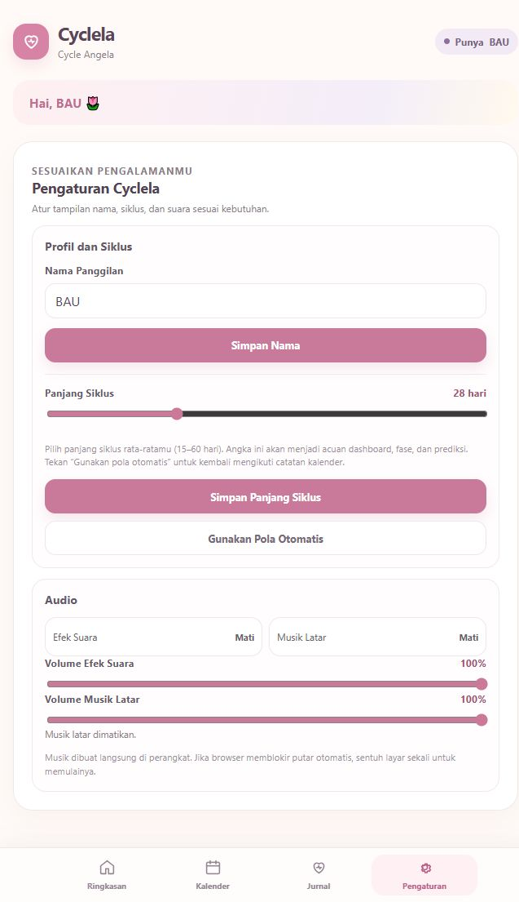
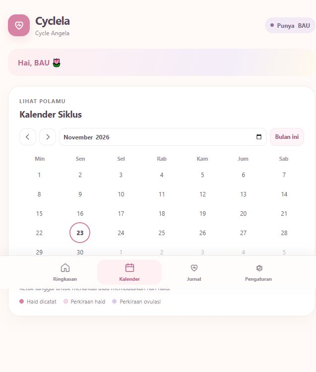
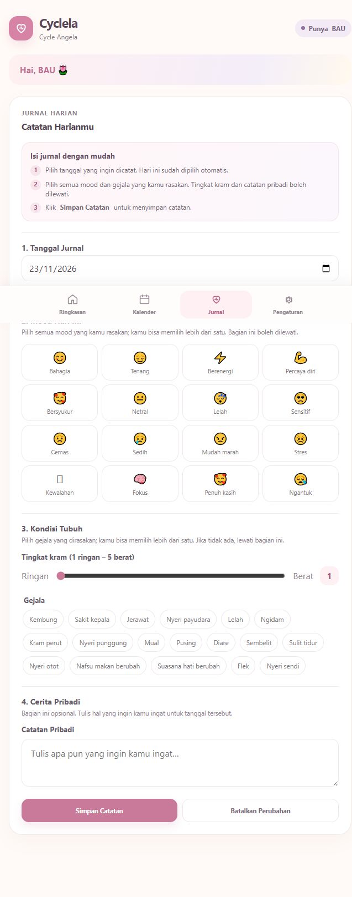
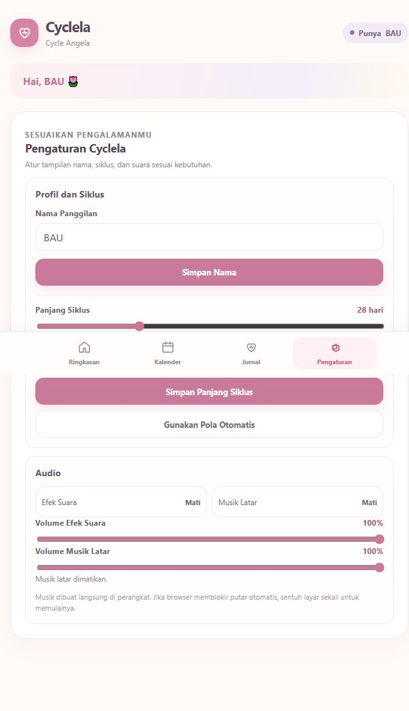

<p align="center">
  
</p>

<h1 align="center">Cyclela</h1>

<p align="center">
  A private space to understand and track your body's cycle.
</p>

<p align="center">
  <a href="README.md">Bahasa Indonesia</a> ·
  <a href="README.en.md"><strong>English</strong></a> ·
  <a href="https://cyclela.vercel.app/">Live Demo</a>
</p>

<p align="center">
  
  
  
  
</p>



## Table of Contents

- [About](#about)
- [Demo](#demo)
- [Key Features](#key-features)
- [Screenshots](#screenshots)
- [Tech Stack](#tech-stack)
- [Project Structure](#project-structure)
- [Run Locally](#run-locally)
- [PWA & Offline](#pwa--offline)
- [Language (i18n)](#language-i18n)
- [Privacy & Data Storage](#privacy--data-storage)
- [License](#license)

## About

**Cyclela** ("Cycle Angela") is a personal progressive web app (PWA) for tracking the menstrual cycle and logging daily health. Designed mobile-first with a warm tone, it runs entirely in the browser — data is stored in `localStorage`, with no backend or server.

## Demo

Try it in your browser: **https://cyclela.vercel.app/**

## Key Features

- **Dashboard (Overview)** — current cycle day, next period estimate, cycle phase (Menstruation, Follicular, Ovulation, Luteal), and a visual phase proportion indicator.
- **Cycle Calendar** — mark period days, forecast next period & ovulation, navigate months/years, color legend.
- **Daily Journal** — log mood (multi-select), cramp level (1–5), body symptoms (18+ options), and a personal note per date.
- **Settings** — profile nickname, cycle length (15–60 days or automatic from recorded pattern), sound effects, background music, volume, and interface language.
- **Audio** — sound effects & background music generated on-device via the Web Audio API.
- **Phase Guide** — short explanations for each cycle phase.
- **PWA** — service worker + manifest; installable and works offline.

## Screenshots

| Overview | Calendar |
| --- | --- |
|  |  |

| Daily Journal | Settings |
| --- | --- |
|  |  |

## Tech Stack

- **HTML5** — structure & accessibility
- **CSS** — Tailwind CSS (via CDN) + custom CSS (variables, responsive, animations)
- **JavaScript (ES6, IIFE)** — application logic, no framework
- **Web Audio API** — sound effects & background music (generated on-device)
- **Service Worker** — asset caching & offline support
- **Web App Manifest** — installation as a PWA
- **localStorage** — on-device data storage (no backend)

No build step, no npm dependencies, no backend.

## Project Structure

```
Cyclela/
├── index.html              # Markup & styling
├── app.js                  # App logic (dashboard, calendar, journal, settings, audio, i18n)
├── sw.js                   # Service worker (offline cache)
├── manifest.json           # PWA manifest
├── README.md               # Documentation (Bahasa Indonesia)
├── README.en.md            # Documentation (English)
├── .gitignore
└── assets/
    ├── icons/              # App icons (svg, png)
    └── screenshots/        # Screenshots for documentation
```

## Run Locally

Just open `index.html` in your browser, or serve with a static server:

```bash
npx serve .
# or
npx http-server .
```

Then open `http://localhost:3000` (or the port shown).

## PWA & Offline

The app registers a service worker (`sw.js`) that caches static assets. After the first visit, Cyclela can be opened without an internet connection. The manifest (`manifest.json`) enables installation to the home screen (Add to Home Screen).

## Language (i18n)

The interface supports **Bahasa Indonesia** and **English**. The choice is saved on the device (localStorage) and can be changed under **Settings → Language**. Default: Bahasa Indonesia.

## Privacy & Data Storage

All data (daily notes, period days, profile settings, audio/language preferences) is stored locally on the user's device via `localStorage`. No data is sent to any server.

## License

Personal project. © Yoganatha Pranashakti.