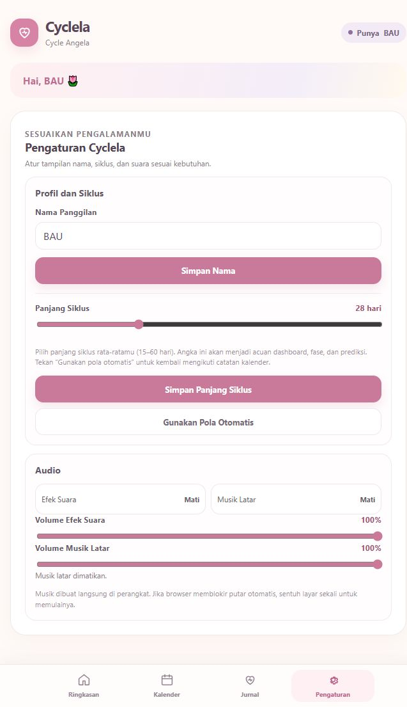
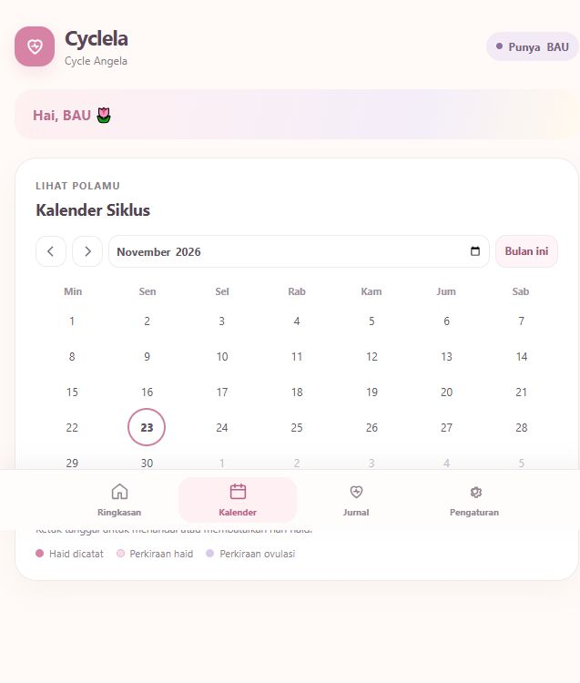
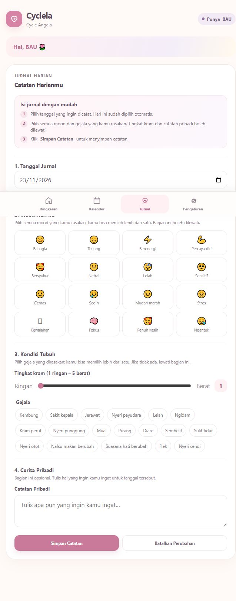
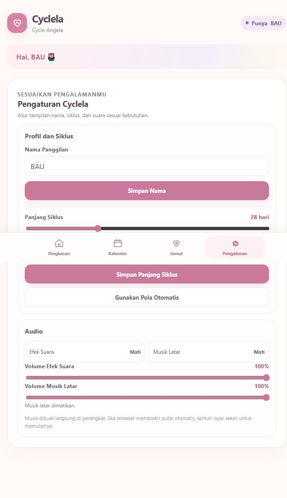

<p align="center">
  
</p>

<h1 align="center">Cyclela</h1>

<p align="center">
  Ruang pribadi untuk mengenali dan mencatat siklus tubuhmu.
</p>

<p align="center">
  <a href="README.md"><strong>Bahasa Indonesia</strong></a> ·
  <a href="README.en.md">English</a> ·
  <a href="https://cyclela.vercel.app/">Demo Live</a>
</p>

<p align="center">
  
  
  
  
</p>



## Daftar Isi

- [Tentang](#tentang)
- [Demo](#demo)
- [Fitur Utama](#fitur-utama)
- [Tangkapan Layar](#tangkapan-layar)
- [Teknologi](#teknologi)
- [Struktur Project](#struktur-project)
- [Menjalankan Lokal](#menjalankan-lokal)
- [PWA & Offline](#pwa--offline)
- [Bahasa (i18n)](#bahasa-i18n)
- [Privasi & Penyimpanan Data](#privasi--penyimpanan-data)
- [Lisensi](#lisensi)

## Tentang

**Cyclela** ("Cycle Angela") adalah aplikasi web progresif (PWA) pribadi untuk melacak siklus menstruasi dan mencatat kesehatan harian. Dirancang mobile-first dengan nuansa hangat, berjalan sepenuhnya di browser — data disimpan di `localStorage`, tanpa backend atau server.

## Demo

Coba langsung di browser: **https://cyclela.vercel.app/**

## Fitur Utama

- **Dashboard (Ringkasan)** — hari siklus saat ini, perkiraan haid berikutnya, fase siklus (Menstruasi, Folikuler, Ovulasi, Luteal), dan indikator visual proporsi fase.
- **Kalender Siklus** — tandai hari-hari haid, prediksi haid & ovulasi berikutnya, navigasi bulan/tahun, legenda warna.
- **Jurnal Harian** — catat mood (multi-pilihan), tingkat kram (1–5), gejala tubuh (18+ pilihan), dan catatan pribadi per tanggal.
- **Pengaturan** — nama panggilan profil, panjang siklus (15–60 hari atau otomatis dari pola catatan), efek suara, musik latar, volume, dan bahasa antarmuka.
- **Audio** — efek suara & musik latar dibuat langsung di perangkat via Web Audio API.
- **Dukungan Fase** — penjelasan singkat untuk setiap fase siklus.
- **PWA** — service worker + manifest, bisa di-install dan bekerja offline.

## Tangkapan Layar

| Ringkasan | Kalender |
| --- | --- |
|  |  |

| Jurnal Harian | Pengaturan |
| --- | --- |
|  |  |

## Teknologi

- **HTML5** — struktur & aksesibilitas
- **CSS** — Tailwind CSS (via CDN) + CSS kustom (variabel, responsive, animasi)
- **JavaScript (ES6, IIFE)** — logika aplikasi tanpa framework
- **Web Audio API** — efek suara & musik latar (dibuat di perangkat)
- **Service Worker** — cache aset & dukungan offline
- **Web App Manifest** — instalasi sebagai PWA
- **localStorage** — penyimpanan data di perangkat (tanpa backend)

Tidak ada build step, tidak ada dependensi npm, tidak ada backend.

## Struktur Project

```
Cyclela/
├── index.html              # Markup & styling
├── app.js                  # Logika aplikasi (dashboard, kalender, jurnal, pengaturan, audio, i18n)
├── sw.js                   # Service worker (offline cache)
├── manifest.json           # PWA manifest
├── README.md               # Dokumentasi (Bahasa Indonesia)
├── README.en.md            # Documentation (English)
├── .gitignore
└── assets/
    ├── icons/              # Ikon aplikasi (svg, png)
    └── screenshots/        # Tangkapan layar untuk dokumentasi
```

## Menjalankan Lokal

Cukup buka `index.html` di browser, atau serve dengan server statis:

```bash
npx serve .
# atau
npx http-server .
```

Lalu buka `http://localhost:3000` (atau port yang ditampilkan).

## PWA & Offline

Aplikasi mendaftarkan service worker (`sw.js`) yang menyimpan aset statis di cache. Setelah kunjungan pertama, Cyclela dapat dibuka tanpa koneksi internet. Manifest (`manifest.json`) memungkinkan instalasi ke layar utama (Add to Home Screen).

## Bahasa (i18n)

Antarmuka mendukung **Bahasa Indonesia** dan **English**. Pilihan disimpan di perangkat (localStorage) dan dapat diubah di **Pengaturan → Bahasa / Language**. Default: Bahasa Indonesia.

## Privasi & Penyimpanan Data

Semua data (catatan harian, hari haid, pengaturan profil, preferensi audio/bahasa) disimpan lokal di perangkat pengguna melalui `localStorage`. Tidak ada data yang dikirim ke server mana pun.

## Lisensi

Proyek personal. © Yoganatha Pranashakti.